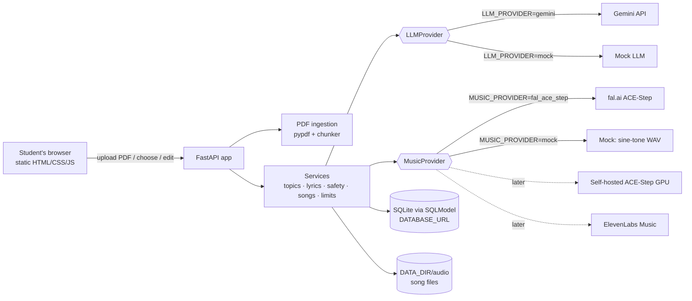

# PLAN.md — StudySongs (PDF → Lyrics → Song)

> Working name: **StudySongs**. Rename freely; nothing depends on the name.
> This file is the single source of truth for the build. Claude Code works through
> Section 9 in order, ticking checkboxes as tasks are completed.

---

## 1. Objective

A web app for school students (under 18) that turns study material into songs:

1. The student uploads a PDF (text-based, up to 30 pages in v1).
2. The app reads it, splits it into sensible sections, and finds the key topics.
3. The student chooses topics, a genre and a mood (or presses **Quick Song** to skip choices).
4. The app writes age-appropriate, factually accurate lyrics with song structure.
5. The student can review and edit the lyrics.
6. The app generates a real song (vocals + music) from the lyrics.
7. The student listens in the browser and downloads the MP3/WAV.

### Definition of a finished first version (MVP)
- The full flow above works end-to-end in the browser, locally and on the deployed URL.
- It works with **mock providers** (no keys, $0) *and* with **real providers** (Gemini + ACE-Step on fal) by changing env vars only.
- Song lengths: 30 s (default), 60 s, 120 s.
- Safety: lyrics are checked before music generation; genres/moods come from fixed lists.
- Cost guards: per-client and global daily limits on song generation.
- Privacy: no accounts, no names, uploaded PDFs are never stored; extracted text and songs are deleted after `RETENTION_HOURS`.
- All tests, lint and type checks pass; production Docker image builds; deploy config is ready.

---

## 2. Architecture

One Python web service (FastAPI) serves both the JSON API and a static single-page frontend.
Slow work (topic extraction, music generation) runs as in-process background tasks; the
browser polls for status. External AI services sit behind **provider interfaces** so they
can be swapped (mock ↔ Gemini, mock ↔ fal ACE-Step ↔ future self-hosted ACE-Step / ElevenLabs).



### Data flow
1. `POST /api/documents` → validate PDF → extract text in memory (PDF bytes discarded) → save `Document(status=processing)` → background task: chunk → topic extraction via LLM → `status=ready` with topics.
2. Browser polls `GET /api/documents/{id}` until `ready` (or `failed`).
3. `POST /api/lyrics` → LLM writes lyrics for chosen topics/genre/mood/duration → `Song(status=draft)` returned.
4. Optional `PATCH /api/songs/{id}` with edited lyrics.
5. `POST /api/songs/{id}/generate` → rate-limit check → safety check → `status=queued` → background task calls MusicProvider → saves audio file → `status=ready`.
6. Browser polls `GET /api/songs/{id}`; plays/downloads `GET /api/songs/{id}/audio`.
7. A cleanup routine deletes expired documents, songs and audio files.

---

## 3. Final tech stack

Package versions: use the latest stable release at build time; `uv.lock` pins them.

| Layer | Choice | Why | Simpler / cheaper alternative |
|---|---|---|---|
| Language | Python 3.12 | Owner knows some Python; best AI/audio ecosystem; future self-hosted model is Python | — |
| Package/env manager | uv | One tool for Python install, venv, deps, lockfile | pip + venv |
| Backend | FastAPI + Uvicorn | Simple, typed, auto docs at `/docs`, background tasks built in | Flask |
| Frontend | Static HTML + CSS + vanilla JS served by FastAPI | No build step, one deploy, easy for a beginner to read | Streamlit (faster, but poor for a public product) |
| Database | SQLite via SQLModel, `DATABASE_URL` | Zero setup; switching to Postgres later is a config change | In-memory dict (loses data, no migrations) |
| Migrations | Alembic | Needed for the future Postgres move | `SQLModel.metadata.create_all` |
| PDF parsing | pypdf (BSD license) | Pure Python, permissive license for commercial use | PyMuPDF is faster but AGPL — avoid for a commercial product |
| Chunking | Custom structure-aware chunker (headings/paragraphs, size-bounded) | Enough "semantic" splitting for study material without embeddings | Fixed-size splitting |
| LLM | Google Gemini Flash via `google-genai` SDK, model from `GEMINI_MODEL` | Free tier, large context, native JSON-schema output | Gemini Flash-Lite (cheaper/faster, slightly weaker) |
| Music | ACE-Step via fal (`fal-client`), endpoint from `FAL_MUSIC_ENDPOINT` | Open-source (Apache-2.0) model, ~$0.0002–0.0003/s, same model can be self-hosted later | RunComfy-hosted ACE-Step (similar price) |
| Settings | pydantic-settings | Typed env config | os.environ |
| HTTP client | httpx | Download generated audio | requests |
| Tests | pytest, FastAPI TestClient, pytest-playwright (E2E), fpdf2 (dev-only, builds fixture PDFs) | Standard, Claude Code knows them well | — |
| Lint / types | ruff (lint + format), mypy | Fast, catches beginner errors | ruff only |
| Hosting | Render free web service, Docker | $0, deploys from GitHub | Hugging Face Spaces (Docker) |

**Explicitly NOT used in v1:** vector database, embeddings, RAG, agents, Redis, task queues,
auth provider, object storage, Postgres service, Node/React build tooling.
The whole PDF (≤30 pages) fits in Gemini's context window, so retrieval is unnecessary.

---

## 4. Data model (SQLite, via SQLModel + Alembic)

All IDs are UUID4 strings. All timestamps are UTC.

### `documents`
| Field | Type | Notes |
|---|---|---|
| id | str PK | uuid4 |
| filename | str(255) | original name, sanitized |
| page_count | int | |
| char_count | int | |
| status | str | `processing` \| `ready` \| `failed` |
| error_code | str nullable | e.g. `no_text`, `llm_unavailable` |
| extracted_text | text nullable | cleared at expiry |
| chunks_json | text nullable | JSON list of `{index, heading, text}` |
| topics_json | text nullable | JSON list of Topic (see §5) |
| client_hash | str(64) | sha256(ip + IP_HASH_SALT) |
| user_id | str nullable | **reserved for future accounts; always NULL in v1** |
| created_at | datetime | |
| expires_at | datetime | created_at + RETENTION_HOURS |

Indexes: `ix_documents_expires_at`, `ix_documents_client_hash_created_at`.

### `songs`
| Field | Type | Notes |
|---|---|---|
| id | str PK | uuid4 |
| document_id | str FK → documents.id, nullable, ON DELETE SET NULL | |
| topic_ids_json | text | JSON list of topic ids used |
| genre | str | must be in GENRES |
| mood | str | must be in MOODS |
| duration_s | int | must be in SONG_DURATIONS |
| title | str(120) | generated by LLM |
| lyrics | text | with `[Verse]`, `[Chorus]`, `[Bridge]`, `[Outro]` markers |
| facts_json | text | JSON list of facts the lyrics teach |
| status | str | `draft` \| `queued` \| `generating` \| `ready` \| `failed` \| `blocked` |
| error_code | str nullable | `unsafe_lyrics`, `provider_error`, `timeout`, `rate_limited`, `interrupted` |
| provider | str nullable | e.g. `mock`, `fal_ace_step` |
| audio_path | str nullable | relative to DATA_DIR |
| audio_mime | str nullable | `audio/mpeg` or `audio/wav` |
| est_cost_usd | float | 0 for mock |
| client_hash | str(64) | |
| user_id | str nullable | reserved, NULL in v1 |
| created_at | datetime | |
| completed_at | datetime nullable | |
| expires_at | datetime | |

Constraints: CHECK on `status` values; CHECK `duration_s > 0`.
Indexes: `ix_songs_status`, `ix_songs_expires_at`, `ix_songs_client_hash_created_at`.

### `usage_events`
| Field | Type | Notes |
|---|---|---|
| id | int PK autoincrement | |
| client_hash | str(64) | |
| kind | str | `document`, `lyrics`, `song` |
| est_cost_usd | float | |
| created_at | datetime | |

Index: `ix_usage_kind_created_at`, `ix_usage_client_kind_created_at`.
Used for rate limits and daily caps.

### Migrations
- `alembic init migrations`; `env.py` reads `DATABASE_URL` from settings and uses `SQLModel.metadata`.
- Migration `0001_initial` creates all three tables, constraints and indexes.
- On app startup: run `alembic upgrade head` programmatically (simple for single-instance deploy).
- SQLite: enable `PRAGMA foreign_keys=ON` and WAL mode on connect.

---

## 5. AI features

All AI calls go through interfaces in `app/providers/`. Business logic never imports a vendor SDK directly.

```python
class LLMProvider(Protocol):
    name: str
    def generate_json(self, system: str, prompt: str, schema: type[BaseModel],
                      temperature: float = 0.4) -> BaseModel: ...

class MusicProvider(Protocol):
    name: str
    def generate(self, req: MusicRequest) -> MusicResult: ...
    def estimate_cost_usd(self, duration_s: int) -> float: ...

@dataclass
class MusicRequest:
    lyrics: str          # with [Verse]/[Chorus] markers
    style_tags: str      # e.g. "pop, upbeat, catchy, bright synths, 120 bpm, clear vocals"
    duration_s: int
    seed: int | None = None

@dataclass
class MusicResult:
    audio_bytes: bytes
    mime: str            # audio/mpeg or audio/wav
    duration_s: float | None
    provider_request_id: str | None
```

A factory (`get_llm_provider()`, `get_music_provider()`) picks the implementation from `LLM_PROVIDER` / `MUSIC_PROVIDER`.
**Tests always force the mock providers**, regardless of `.env`.

### 5.1 Topic extraction ("which parts of the PDF matter")
- **Model:** Gemini Flash (`GEMINI_MODEL`), provider `gemini`. Mock: returns topics built from chunk headings/first sentences.
- **Why an LLM:** judging what's important for learning needs understanding. No embeddings/RAG: ≤30 pages fits in context.
- **Input:** chunks from the chunker.
- **Strategy:**
  - If total text ≤ `SINGLE_PASS_MAX_CHARS` (default 60,000): one call with all chunks (labelled `[Section i: heading]`).
  - Else (future long PDFs): **map** — extract up to 4 topics per group of chunks; **reduce** — merge, dedupe and rank to the final list. Calls are sequential with backoff to respect free-tier rate limits.
- **Output schema:**
  ```json
  {"topics": [{"id": "t1", "title": "Photosynthesis inputs", "summary": "≤40 words",
               "key_facts": ["≤20 words each", "..."], "importance": 1-5,
               "source_sections": [0, 2]}]}
  ```
  5–10 topics, sorted by importance descending. Validate with Pydantic; on invalid JSON retry once with a "return valid JSON only" reminder.
- **System prompt (store in `app/prompts/topics.py`):**
  > You are an expert teacher. From the study material, identify the 5–10 most important ideas a school student must learn. Prefer core concepts, definitions, processes, cause→effect, key dates/numbers. Ignore tables of contents, references, page headers/footers and exercises. Every key fact must be stated in the material — never add outside facts. Output JSON matching the schema.
- **Errors:** provider errors → retry 2× (exponential backoff 2 s, 6 s) → `Document.status=failed, error_code=llm_unavailable`. Empty topic list → `failed, no_topics`.
- **Cost:** $0 on free tier. One call per upload in v1.

### 5.2 Lyrics writing
- **Model:** Gemini Flash. Mock: deterministic template lyrics using the topic titles/facts.
- **Input:** selected topics (title + key_facts), genre, mood, duration_s.
- **Length guide by duration:**
  - 30 s: `[Verse]` 4 lines + `[Chorus]` 4 lines
  - 60 s: `[Verse]` 4 + `[Chorus]` 4 + `[Verse]` 4 + `[Chorus]` 4
  - 120 s: two verses, chorus ×3, `[Bridge]` 4 lines, `[Outro]` 2 lines
- **Output schema:** `{"title": str ≤60 chars, "lyrics": str, "facts_covered": [str]}`
- **System prompt (`app/prompts/lyrics.py`):**
  > You write catchy, memorable educational songs for school students aged 10–17. Use ONLY facts provided. Keep facts accurate — never distort a fact to make a rhyme. Put the single most important idea in the chorus so it repeats. Short lines (4–10 words) that are easy to sing. No profanity, violence, romance, drugs, brand names, real artists, or references to existing songs. Use section markers on their own lines: [Verse], [Chorus], [Bridge], [Outro]. Match the genre and mood. Output JSON matching the schema.
- **Validation (code, after the LLM):** must contain at least one `[Verse]` and one `[Chorus]`; total lines within ±50% of the guide; max 3,000 chars. If invalid, retry once with the specific problem stated; then return 502 `lyrics_generation_failed`.
- **Cost:** $0 on free tier.

### 5.3 Safety check (students are under 18)
- Runs on the **final** lyrics (after any user edits) before music generation, and on user-edited lyrics on PATCH.
- **Layer 1 — blocklist** (`app/safety/blocklist.txt`, word-boundary, case-insensitive): profanity, slurs, sexual terms, drug terms, self-harm terms. Always runs, works offline.
- **Layer 2 — LLM check** (Gemini): schema `{"safe": bool, "category": "ok"|"profanity"|"sexual"|"violence"|"self_harm"|"hate"|"drugs"|"existing_song_lyrics"|"personal_info"|"other", "reason": str}`. Prompt asks whether the text is suitable for an educational app for 10–17-year-olds, and whether it appears to reproduce lyrics of an existing published song or contains personal information (names + contact details, addresses).
- **Fallback:** if the LLM check fails/unavailable, rely on blocklist only and log a warning. Mock provider: always `safe` unless blocklist hits.
- Blocked → `Song.status=blocked`, `error_code=unsafe_lyrics`, friendly message; no music cost incurred.
- Genres and moods are **fixed lists** — users cannot type artist names into the music style.

### 5.4 Music generation
- **Provider:** `fal_ace_step` using `fal-client` (`fal_client.subscribe(FAL_MUSIC_ENDPOINT, arguments=...)`). Mock: generates a valid WAV (sine-tone melody, `duration_s` long, stdlib `wave` + `math`, no deps).
- **Before implementing**, fetch the fal model page / API schema for `FAL_MUSIC_ENDPOINT` (default `fal-ai/ace-step`) and match the exact input/output field names. Expected shape: inputs `tags` (comma-separated style), `lyrics` (with section markers), `duration` (seconds); output contains an audio file URL. If the schema differs, adapt the adapter only.
- **Lyrics normalization in adapter:** convert `[Verse]` → `[verse]`, etc., if the provider expects lowercase markers.
- **Style tags:** built in code from fixed maps in `app/music/styles.py`:
  - GENRES: `pop, hip_hop, rock, country, acoustic_folk, electronic, rnb, reggae, musical_theatre, lullaby`
  - MOODS: `upbeat, calm, energetic, playful, dramatic`
  - each maps to tag strings, e.g. `pop` → `"pop, catchy, bright synths, clear lead vocals"`, `upbeat` → `"upbeat, happy, 120 bpm"`. Always append `"clear vocals, clean lyrics"`.
- **Flow:** download the result URL with httpx (timeout 60 s) → save to `DATA_DIR/audio/{song_id}.{ext}`.
- **Timeouts/errors:** overall `MUSIC_TIMEOUT_S` (default 300). 1 retry on transient errors (5xx/network). Then `status=failed, error_code=provider_error|timeout`. Never retry on 4xx.
- **Startup recovery:** any song left in `queued`/`generating` at startup → `failed, error_code=interrupted`.
- **Cost:** ≈ $0.0002–0.0003 per second of audio → 30 s ≈ $0.01, 120 s ≈ $0.04. Logged in `est_cost_usd` and `usage_events` using `MUSIC_COST_PER_SECOND_USD`.

### 5.5 Quick Song
Uses the top 3 topics by importance, `genre=pop`, `mood=upbeat`, `duration=DEFAULT_SONG_DURATION`, writes lyrics, runs safety, queues generation — one request.

---

## 6. API specification

No authentication in v1. All errors return:
```json
{"error": {"code": "snake_case_code", "message": "Human-friendly message for students"}}
```
Every request derives `client_hash` from the first IP in `X-Forwarded-For` (else `request.client.host`) + `IP_HASH_SALT`. Raw IPs are never stored or logged.

| Method & path | Request | Success | Errors |
|---|---|---|---|
| `GET /` | — | HTML app | — |
| `GET /api/health` | — | `200 {"status":"ok","llm":"mock","music":"mock"}` | — |
| `GET /api/options` | — | `200 {"genres":[{"id","label"}], "moods":[...], "durations":[30,60,120], "default_duration":30, "limits":{"max_upload_mb":10,"max_pages":30}}` | — |
| `POST /api/documents` | multipart `file` (PDF) | `202 {"document_id","status":"processing"}` | 400 `not_a_pdf`, 413 `file_too_large`, 422 `too_many_pages`, 422 `no_text` (scanned/image PDF), 422 `encrypted_pdf`, 429 `rate_limited` |
| `GET /api/documents/{id}` | — | `200 {"id","filename","page_count","status","error_code","topics":[Topic]\|null}` | 404 `not_found` (also when expired) |
| `POST /api/lyrics` | `{"document_id","topic_ids":[≥1, ≤5],"genre","mood","duration_s"}` | `201 {"song_id","title","lyrics","facts_covered","status":"draft"}` | 404, 409 `document_not_ready`, 422 `invalid_option`/`invalid_topics`, 429, 502 `lyrics_generation_failed`, 503 `llm_unavailable` |
| `PATCH /api/songs/{id}` | `{"lyrics": str}` (1–3000 chars) | `200 SongOut` | 404, 409 `not_editable` (status ≠ draft/failed/blocked), 422 `invalid_lyrics` (missing markers / too long), 422 `unsafe_lyrics` (blocklist hit) |
| `POST /api/songs/{id}/generate` | — | `202 {"song_id","status":"queued"}` | 404, 409 `already_generating`/`already_ready`, 422 `unsafe_lyrics`, 429 `rate_limited` (per client), 503 `daily_capacity_reached` (global cap) |
| `GET /api/songs/{id}` | — | `200 SongOut` = `{"id","title","lyrics","facts_covered","genre","mood","duration_s","status","error_code","audio_url"\|null,"expires_at"}` | 404 |
| `GET /api/songs/{id}/audio` | `?download=1` optional | `200` audio stream (`Content-Disposition: attachment` when download=1) | 404, 409 `not_ready` |
| `POST /api/quick-song` | `{"document_id"}` | `202 {"song_id","status":"queued"}` | as for lyrics + generate |

Limits (env-configurable): `DOCS_PER_CLIENT_PER_DAY=10`, `SONGS_PER_CLIENT_PER_DAY=5`, `SONGS_GLOBAL_PER_DAY=50`. Lyrics calls: `LYRICS_PER_CLIENT_PER_DAY=30`.

---

## 7. Repository structure

```
studysongs/
├── CLAUDE.md                # rules + commands for Claude Code
├── PLAN.md                  # this file
├── PROGRESS.md              # build log (Claude Code maintains)
├── README.md                # how to run, deploy, configure
├── pyproject.toml           # deps + ruff/mypy/pytest config
├── uv.lock
├── .env.example
├── .gitignore               # .env, data/, .venv, __pycache__, test artifacts
├── Dockerfile
├── render.yaml              # Render blueprint
├── alembic.ini
├── migrations/              # Alembic env + versions/0001_initial.py
├── scripts/
│   ├── check.sh             # ruff + mypy + pytest (non-E2E) in one command
│   └── smoke_live.py        # ONE real call per provider; run manually only
├── app/
│   ├── main.py              # FastAPI app, startup (migrations, recovery, cleanup loop), static mount
│   ├── config.py            # Settings (pydantic-settings)
│   ├── db.py                # engine, session dependency, SQLite pragmas
│   ├── models.py            # SQLModel tables
│   ├── schemas.py           # API request/response models, Topic, SongOut
│   ├── errors.py            # AppError + exception handlers → error JSON
│   ├── deps.py              # client_hash, providers, settings dependencies
│   ├── api/
│   │   ├── documents.py
│   │   ├── songs.py         # lyrics, patch, generate, get, audio, quick-song
│   │   └── meta.py          # health, options
│   ├── ingestion/
│   │   ├── pdf.py           # validate + extract text (pypdf)
│   │   └── chunker.py       # clean + structure-aware chunking
│   ├── services/
│   │   ├── topics.py        # single-pass / map-reduce extraction
│   │   ├── lyrics.py        # generate + validate lyrics
│   │   ├── songs.py         # generation job, file saving
│   │   ├── limits.py        # rate limits + daily caps via usage_events
│   │   └── cleanup.py       # delete expired rows + files
│   ├── safety/
│   │   ├── checker.py
│   │   └── blocklist.txt
│   ├── music/styles.py      # GENRES, MOODS, tag builder
│   ├── prompts/             # topics.py, lyrics.py, safety.py
│   ├── providers/
│   │   ├── llm/   base.py, gemini.py, mock.py, factory.py
│   │   └── music/ base.py, fal_ace_step.py, mock.py, factory.py
│   └── static/              # index.html, styles.css, app.js, privacy.html
└── tests/
    ├── conftest.py          # forces mocks, temp DB + DATA_DIR, fixture PDF builders (fpdf2)
    ├── unit/                # chunker, pdf, styles, safety, lyrics validation, limits, mock providers
    ├── integration/         # API flows with TestClient
    ├── live/                # @pytest.mark.live — skipped unless RUN_LIVE=1
    └── e2e/                 # Playwright happy path + error path (mock providers)
```

---

## 8. Environment configuration — `.env.example`

```dotenv
# ===== Non-secret settings (safe to commit these defaults) =====
APP_ENV=development                 # development | production
DATABASE_URL=sqlite:///./data/app.db
DATA_DIR=./data
LOG_LEVEL=INFO

# Providers: mock costs $0 and needs no keys
LLM_PROVIDER=mock                   # mock | gemini
MUSIC_PROVIDER=mock                 # mock | fal_ace_step
GEMINI_MODEL=gemini-2.5-flash       # verify current model name at Task 0
FAL_MUSIC_ENDPOINT=fal-ai/ace-step  # verify schema at Task 11
MUSIC_COST_PER_SECOND_USD=0.0003    # for cost estimates/logging only
MUSIC_TIMEOUT_S=300

# Limits
MAX_UPLOAD_MB=10
MAX_PDF_PAGES=30
SINGLE_PASS_MAX_CHARS=60000
SONG_DURATIONS=30,60,120
DEFAULT_SONG_DURATION=30
DOCS_PER_CLIENT_PER_DAY=10
LYRICS_PER_CLIENT_PER_DAY=30
SONGS_PER_CLIENT_PER_DAY=5
SONGS_GLOBAL_PER_DAY=50
RETENTION_HOURS=24

# ===== SECRETS (never commit real values) =====
GEMINI_API_KEY=
FAL_KEY=
IP_HASH_SALT=change-me-to-a-long-random-string
```

There is no separate frontend build, so there are **no public/browser-exposed variables**. All values are read server-side only.

---

## 9. Autonomous implementation sequence

Rules for every task: build it → write tests → `scripts/check.sh` passes → tick the box →
add a PROGRESS.md entry → `git commit`. The app must start (`uv run uvicorn app.main:app`) after every task.
**Keep `LLM_PROVIDER=mock` and `MUSIC_PROVIDER=mock` while building** except where a task says otherwise.

### MUST BUILD (MVP)

- [ ] **Task 0 — Bootstrap**
  - Build: `uv init`, Python 3.12, add deps (`fastapi`, `uvicorn[standard]`, `sqlmodel`, `alembic`, `pydantic-settings`, `pypdf`, `google-genai`, `fal-client`, `httpx`, `python-multipart`); dev deps (`pytest`, `ruff`, `mypy`, `fpdf2`, `pytest-playwright`). Configure ruff, mypy (strict-ish: `disallow_untyped_defs = true` for `app/`), pytest markers `live` and `e2e`. Create `.gitignore`, `.env.example` (§8), `scripts/check.sh`, `PROGRESS.md`, minimal `app/main.py` with `GET /api/health`.
  - If `GEMINI_API_KEY` is set in `.env`, make **one** cheap call listing available models to confirm `GEMINI_MODEL` exists; if not, pick the current Flash model and update `.env.example` + PROGRESS.md.
  - Tests: health endpoint returns 200.
  - Done when: `scripts/check.sh` passes and the server starts.

- [ ] **Task 1 — Config, errors, logging**
  - Files: `config.py`, `errors.py`, `deps.py`.
  - Behavior: `Settings` loads all §8 vars with types/defaults; `SONG_DURATIONS` parsed to `list[int]`; `AppError(code, message, status)` handled globally into the error JSON shape; unhandled exceptions → 500 `internal_error` without stack traces in responses. `client_hash` dependency.
  - Tests: settings parsing; error handler shape; client_hash uses X-Forwarded-For first IP and never returns raw IP.

- [ ] **Task 2 — Database & migrations**
  - Files: `db.py`, `models.py`, `alembic.ini`, `migrations/`.
  - Behavior: tables per §4; startup runs `alembic upgrade head`; SQLite pragmas.
  - Tests: migration creates tables on a temp DB; CHECK constraint rejects bad status; FK set-null works.

- [ ] **Task 3 — Provider interfaces + mocks**
  - Files: `providers/llm/{base,mock,factory}.py`, `providers/music/{base,mock,factory}.py`.
  - Behavior: per §5. Mock LLM returns schema-valid objects for topics, lyrics and safety (dispatch on schema type). Mock music returns a valid WAV of exactly `duration_s` seconds (8 kHz mono is fine to keep it small).
  - Tests: mock outputs validate against schemas; WAV header/duration correct; factory selects by env; unknown provider name raises clear error at startup.

- [ ] **Task 4 — PDF ingestion & chunking**
  - Files: `ingestion/pdf.py`, `ingestion/chunker.py`, `tests/conftest.py` (fpdf2 fixture builders).
  - Behavior: reject non-PDF (magic bytes `%PDF`), >`MAX_UPLOAD_MB`, encrypted, >`MAX_PDF_PAGES`; extract text per page; if <200 meaningful chars total → `no_text`. Clean: remove repeated header/footer lines (lines appearing on >50% of pages), page numbers, hyphenation at line ends, collapse whitespace. Chunk: detect headings (short line, title/upper case or numbered like `2.1`), split into sections; merge small sections and split large ones on paragraph boundaries so each chunk is ~800–3,000 chars. Output `list[Chunk(index, heading, text)]`.
  - Tests: each rejection case; header/footer removal; headings detected; chunk size bounds; multi-page fixture produces stable chunks.

- [ ] **Task 5 — Topic extraction service**
  - Files: `services/topics.py`, `prompts/topics.py`.
  - Behavior: §5.1 single-pass and map-reduce paths; Pydantic validation; retry/backoff; topic ids `t1..tn`; importance-sorted.
  - Tests (mock LLM + a fake LLM that fails N times / returns invalid JSON): single-pass chosen under threshold; map-reduce chosen above it; retries then `llm_unavailable`; invalid JSON retried once.

- [ ] **Task 6 — Documents API**
  - Files: `api/documents.py`, `services/limits.py` (document limit part).
  - Behavior: §6 `POST/GET /api/documents`; PDF bytes never written to disk; background task runs chunking + topics; usage event recorded.
  - Tests: happy path upload → poll → ready with topics; each error code; rate limit 429 after `DOCS_PER_CLIENT_PER_DAY`; expired doc → 404.

- [ ] **Task 7 — Styles + lyrics service + endpoints**
  - Files: `music/styles.py`, `services/lyrics.py`, `prompts/lyrics.py`, `api/songs.py` (`POST /api/lyrics`, `PATCH /api/songs/{id}`, `GET /api/songs/{id}`), `api/meta.py` (`/api/options`).
  - Behavior: §5.2 incl. validation + one corrective retry; creates `Song(draft)`; PATCH validates markers/length and blocklist.
  - Tests: options lists; lyrics created for each duration with correct structure; invalid genre/topic ids → 422; doc not ready → 409; PATCH rules.

- [ ] **Task 8 — Safety checker**
  - Files: `safety/checker.py`, `safety/blocklist.txt`, `prompts/safety.py`.
  - Behavior: §5.3 two layers + fallback.
  - Tests: blocklist hit blocks (word-boundary: "class" must not match a blocked substring); LLM "unsafe" blocks; LLM failure falls back to blocklist; clean text passes.

- [ ] **Task 9 — Song generation, audio, limits, recovery**
  - Files: `services/songs.py`, `services/limits.py`, `api/songs.py` (`generate`, `audio`), `main.py` startup recovery.
  - Behavior: §5.4 flow with mock provider; per-client and global caps checked **before** any provider call; usage events with estimated cost; audio saved under `DATA_DIR/audio`; audio endpoint streams with correct MIME and optional download header; startup marks stuck jobs `interrupted`.
  - Tests: draft → queued → ready with playable audio; unsafe lyrics → 422 and no provider call; caps → 429/503; provider failure → failed; double generate → 409; recovery on startup.

- [ ] **Task 10 — Quick Song endpoint**
  - Behavior: §5.5.
  - Tests: one request yields a ready song (mock); respects limits.

- [ ] **Task 11 — Real providers**
  - Files: `providers/llm/gemini.py`, `providers/music/fal_ace_step.py`, `tests/live/`, `scripts/smoke_live.py`.
  - Behavior: Gemini via `google-genai` with JSON response schema from the Pydantic model; map SDK errors to retryable/non-retryable. fal adapter: **first fetch the fal docs for `FAL_MUSIC_ENDPOINT`** and match field names; normalize lyrics markers; download audio; estimate cost.
  - Tests: unit tests with the SDK calls monkeypatched (no network). Live tests marked `live`, skipped unless `RUN_LIVE=1`.
  - `smoke_live.py` builds the real providers directly from the keys, regardless of `LLM_PROVIDER`/`MUSIC_PROVIDER` (which stay `mock` during the build).
  - Run **once**, only if both keys are present: `RUN_LIVE=1 uv run python scripts/smoke_live.py` → one topics call, one lyrics call, **one 30-second song**. Record result + cost estimate in PROGRESS.md. If a key is missing or the call fails, log it in PROGRESS.md and continue — mocks keep the app working.

- [ ] **Task 12 — Frontend**
  - Files: `app/static/index.html`, `styles.css`, `app.js`, `privacy.html`; static mount in `main.py`.
  - Behavior: one page, four steps with a progress indicator:
    1. **Upload** — drag-and-drop + file picker; client-side checks (type, size); spinner with "Reading your PDF…"; poll every 2 s (stop after 3 min with a timeout message).
    2. **Choose** — topic cards (title, summary, importance) as checkboxes (max 5, top 3 pre-selected); genre/mood dropdowns from `/api/options`; length radio (30 s default, 60 s, 2 min); buttons "Write lyrics" and "Quick Song ⚡".
    3. **Lyrics** — editable textarea with section markers, title, "What this song teaches" (facts list); buttons "Make my song" and "Rewrite lyrics".
    4. **Listen** — "Composing your song… (this can take a minute)" state; poll every 3 s up to `MUSIC_TIMEOUT_S`; `<audio controls>`; Download button; "Make another" restart.
  - Every API error code maps to a friendly student-facing message. Empty, loading and error states for each step. Buttons disabled while requests are in flight (prevents double-spend). Mobile-friendly (works at 360 px wide), keyboard accessible, labels on all inputs, good contrast. Footer link to privacy page: no accounts, PDFs not stored, text and songs deleted after 24 hours, don't upload personal information.
  - No frameworks, no CDN scripts; plain ES modules.
  - Tests: covered by Task 13 E2E.

- [ ] **Task 13 — End-to-end tests**
  - Files: `tests/e2e/`.
  - Behavior: start the app on a free port with mock providers and temp data dir; Playwright: upload fixture PDF → choose → write lyrics → edit → generate → audio element has a source → download works. Second test: upload a non-PDF → friendly error shown. Third: Quick Song path.
  - Run with `uv run playwright install chromium` once, then `uv run pytest -m e2e`.

- [ ] **Task 14 — Cleanup & privacy hardening**
  - Files: `services/cleanup.py`, `main.py`.
  - Behavior: on startup and every 30 minutes (asyncio background loop), delete expired documents/songs and their audio files; clear `extracted_text`/`chunks_json` at expiry. Logs never include PDF text, lyrics or raw IPs.
  - Tests: expired rows + files removed; non-expired kept.

- [ ] **Task 15 — Deployment config & production build**
  - Files: `Dockerfile` (python:3.12-slim, uv install, non-root user, `uvicorn app.main:app --host 0.0.0.0 --port ${PORT:-8000} --workers 1`), `render.yaml` (web service, docker runtime, free plan, healthCheckPath `/api/health`, env vars with `sync: false` for secrets), `README.md`.
  - Behavior: single worker (in-process background tasks + SQLite). `APP_ENV=production` disables `/docs`.
  - Verify: `docker build` succeeds and the container serves `/api/health` (if Docker is unavailable, run `uv run uvicorn` with `APP_ENV=production` and note it in PROGRESS.md).

- [ ] **Task 16 — Final verification**
  - Run full `scripts/check.sh`, E2E tests, production build; walk the §13 checklist; update README and PROGRESS.md with a final summary, known limitations and assumptions.

### SHOULD BUILD IF TIME (only after Task 16 passes)
- [ ] "Rewrite lyrics" variations: pass a `variation_hint` (e.g. "funnier", "simpler words").
- [ ] Show which PDF sections each topic came from (using `source_sections`).
- [ ] Simple anonymous feedback buttons (👍/👎) per song stored in a new table.

### LATER (do NOT build now — architecture already allows it)
- Accounts + saved song library (`user_id` columns already exist).
- Postgres (e.g. Neon) + object storage (e.g. Cloudflare R2) for audio — change `DATABASE_URL`, add a storage interface.
- Self-hosted ACE-Step on a GPU server (new `MusicProvider` calling your own HTTP endpoint).
- ElevenLabs Music as a premium-quality provider.
- Long textbooks (80+ pages) — map-reduce path already exists; raise `MAX_PDF_PAGES`, add page-range selection.
- OCR for scanned PDFs.
- Teacher/classroom features, sharing links, quizzes generated from the lyrics.

---

## 10. MVP vs extensions summary

| MUST BUILD | SHOULD BUILD IF TIME | LATER |
|---|---|---|
| Tasks 0–16 | Rewrite variations, topic sources, feedback | Accounts, Postgres/R2, self-hosted model, ElevenLabs, long PDFs, OCR, classrooms |

---

## 11. Testing & verification

- **Unit:** chunker, PDF validation, styles/tag builder, lyrics validation, safety layers, limits math, mock providers, settings, error shapes.
- **Integration (TestClient, mock providers):** every endpoint's success and documented error codes; full flow upload → topics → lyrics → patch → generate → audio.
- **E2E (Playwright, mock providers):** happy path, quick path, bad-file path.
- **AI/API failure cases:** LLM timeout/5xx/invalid JSON (retry → error code); music provider 5xx (retry once), 4xx (no retry), timeout; download failure; safety LLM unavailable (blocklist fallback).
- **States:** empty PDF / scanned PDF; zero topics; generation interrupted by restart; expired resources → 404.
- **Database:** constraints, FK behavior, migrations from empty DB.
- **Cost safety:** tests assert no provider call happens when a limit or safety block applies.
- **Production build:** Docker image builds and serves health check.
- `scripts/check.sh` = `ruff check . && ruff format --check . && mypy app && pytest -m "not live and not e2e"`.

---

## 12. Deployment (Render free tier)

Claude Code prepares everything; the owner clicks through Render once.

1. Push `main` to GitHub.
2. Render dashboard → **New → Blueprint** → select the repo (uses `render.yaml`).
3. Set secret env vars in Render: `GEMINI_API_KEY`, `FAL_KEY`, `IP_HASH_SALT` (new random string). Set `LLM_PROVIDER=gemini`, `MUSIC_PROVIDER=fal_ace_step`, `APP_ENV=production`.
4. Deploy; open `https://<service>.onrender.com/api/health`.
5. Run through the app once with a short PDF and a 30 s song.

Free-tier realities (document in README): first visit after 15 idle minutes takes ~1 minute to wake; files and the SQLite DB reset on restart/redeploy (acceptable: songs are temporary and downloadable). Moving to the $7/month Starter instance removes sleeping.

---

## 13. Final acceptance checklist

- [ ] `scripts/check.sh` passes (ruff, format, mypy, unit + integration tests).
- [ ] `pytest -m e2e` passes.
- [ ] Docker image builds and `/api/health` returns 200 in the container.
- [ ] With mock providers: full flow works in a browser, including Quick Song, edit lyrics, play, download.
- [ ] With real providers (if keys present): smoke test produced a real 30 s song; result logged.
- [ ] Every documented error code shows a friendly message in the UI.
- [ ] Unsafe lyrics are blocked before any music provider call.
- [ ] Rate limits and global daily cap enforced before any provider call.
- [ ] PDF bytes never saved; expired data deleted; logs contain no PDF text, lyrics or raw IPs.
- [ ] Switching providers requires only env var changes.
- [ ] No TODOs left in core paths (`grep -rn TODO app/` is empty or only refers to LATER items).
- [ ] README explains local run, tests, env vars, deploy, costs and free-tier limits.
- [ ] PROGRESS.md lists all decisions and assumptions made during the build.

---

## 14. Rules for Claude Code

- Work through Section 9 tasks **in order**; tick each checkbox when done.
- After each task: run `scripts/check.sh`, fix failures, then commit with a clear message (`feat: task 4 pdf ingestion and chunking`).
- Keep `PROGRESS.md` updated: what was done, decisions, assumptions, anything skipped and why.
- Don't change the agreed architecture or add dependencies without a strong reason; log it in PROGRESS.md if you do.
- If an external service is unavailable or a key is missing, keep the clean abstraction, use the mock, log it, and continue — never stop the build for it.
- Never leave core features as TODOs. Finish all MUST BUILD tasks before any SHOULD BUILD item.
- **Cost rules:** tests always use mock providers. Real music generation happens only in the single Task 11 smoke run (one 30 s song). Never loop or batch real API calls.
- Never commit `.env` or secrets. Never print secret values.
- Run the production build (Task 15) before declaring the project done.
- Make reasonable decisions yourself instead of stopping to ask; record them in PROGRESS.md.
